# Clasificación de Estratos Morfológicos con DBSCAN en Dos Etapas y MLP (`scikit-learn`)


Pipeline completo y reproducible de **Minería de Datos** (BUAP — Facultad de Ciencias de la Computación) para descubrir estratos morfológicos de granos mediante **DBSCAN en dos etapas** y entrenar una **Red Neuronal Artificial (`MLPClassifier`)** optimizada con validación cruzada estratificada, regla parsimoniosa de un error estándar (1-SE), pruebas de variación estadística y evaluación fuera de distribución (OOD).

---

## Tabla de Contenidos

- [Descripción del Proyecto](#descripción-del-proyecto)
- [Arquitectura del Flujo](#arquitectura-del-flujo)
- [Estructura del Repositorio](#estructura-del-repositorio)
- [Nota sobre Inclusión del Dataset](#nota-sobre-inclusión-del-dataset)
- [Instalación (Linux y Windows)](#instalación-linux-y-windows)
- [Ejecución Paso a Paso](#ejecución-paso-a-paso)
- [Inferencia Rápida con el Modelo Entrenado](#inferencia-rápida-con-el-modelo-entrenado)
- [Resumen de Resultados Esperados](#resumen-de-resultados-esperados)
- [Integrantes y Créditos](#integrantes-y-créditos)
- [Licencia](#licencia)

---

## Descripción del Proyecto

A partir de `data/raw/Dataset.csv` (`13,611` instancias × `16` atributos morfológicos geométricos + columna 16 residual vacía), el proyecto implementa cuatro fases secuenciales desacopladas y libres de fuga de datos:

1. **Preprocesamiento y Clustering DBSCAN en dos etapas (`src/preprocesameinto.py`)**: limpia duplicados y nulos, separa atípicos globales en 16D con `RobustScaler`, preserva una subpoblación minoritaria de granos gigantes como clase propia y descubre tres estratos internos sobre `PCA(2)` del grupo principal. *(El nombre `preprocesameinto.py` conserva literalmente la ortografía especificada en la rúbrica del curso.)*
2. **Muestreo estratificado y ablación controlada (`src/muestreo.py`)**: construye particiones disjuntas `70 % train / 15 % validation / 15 % test`, valida homogeneidad mediante pruebas Kolmogorov–Smirnov y $\chi^2$, y genera brazos de duplicación simple y SMOTE exclusivamente sobre `train.csv`.
3. **Optimización MLP (`src/entrenamiento.py`)**: ejecuta `GridSearchCV` en dos etapas (`240` combinaciones gruesas + `24` finas) con `StandardScaler` encapsulado dentro de `Pipeline`, selecciona el modelo mediante la regla **1-SE** (`(64, 32)`, `tanh`, `Adam`, $\alpha=0.01$), estudia el efecto del número de épocas sin parada temprana y decide el balanceo únicamente sobre `validation.csv`.
4. **Evaluación experimental y variación estadística (`src/evaluacion_experimentos.py`)**: evalúa `test.csv` una sola vez frente a modelos base (`LogisticRegression`, `NearestCentroid`), analiza entropía de Shannon fuera de distribución sobre el ruido descartado y estima varianza mediante 20 semillas, `RepeatedStratifiedKFold(5×10)` con prueba *t* corregida de Nadeau–Bengio y Bootstrap estratificado ($B=1{,}000$).

---

## Arquitectura del Flujo

```mermaid
flowchart LR
    A["data/raw/Dataset.csv<br/>(13,611 x 17)"] --> B["1. src/preprocesameinto.py<br/>Limpieza + DBSCAN 2 etapas"]
    B --> C["data/processed/<br/>dataset_limpio_clusters.csv (11,776, 4 clases)<br/>ruido_descartado.csv (1,767)"]
    C --> D["2. src/muestreo.py<br/>Split estratificado 70/15/15 + KS/Chi2"]
    D --> E["train (8,243) / val (1,766) / test (1,767)<br/>+ train_dup / train_smote"]
    E --> F["3. src/entrenamiento.py<br/>GridSearchCV (240+24) + Regla 1-SE<br/>Ablación decidida solo en validation"]
    F --> G["models/*.joblib<br/>MLP 1-SE + Baselines"]
    G --> H["4. src/evaluacion_experimentos.py<br/>Test único + OOD + 20 semillas + RSKF + Bootstrap"]
    H --> I["results/<br/>27 tablas CSV + 17 figuras PNG"]
```



---

## Estructura del Repositorio

Los artefactos temporales (`train.csv`, `validation.csv`, `test.csv`, brazos de ablación, `models/` y `results/`) no se versionan en Git: se recrean localmente al ejecutar los scripts. En `data/` se incluyen ambos datasets clave (el **crudo** original y el **limpio** ya depurado y etiquetado por DBSCAN):

```text
.
├── .gitignore
├── LICENSE
├── README.md
├── requirements.txt
├── data/
│   ├── raw/
│   │   ├── Dataset.csv                    # Dataset morfológico crudo (13,611 x 17)
│   │   └── Dataset.txt                    # Descripción de las 16 variables
│   └── processed/
│       └── dataset_limpio_clusters.csv    # Dataset limpio y etiquetado (11,776 x 17, 4 clases)
└── src/
    ├── preprocesameinto.py                # Fase 1: limpieza, EDA y DBSCAN en dos etapas
    ├── muestreo.py                        # Fase 2: muestreo estratificado 70/15/15 y CV
    ├── entrenamiento.py                   # Fase 3: modelos base, GridSearchCV y regla 1-SE
    └── evaluacion_experimentos.py         # Fase 4: test único, OOD, sintéticos/crudo y RSKF
```

---

## Nota sobre Inclusión del Dataset

Este repositorio incluye intencionalmente tanto el dataset crudo (`data/raw/Dataset.csv`, `2.3 MiB`) como el dataset limpio y etiquetado (`data/processed/dataset_limpio_clusters.csv`, `2.1 MiB`) junto con `data/raw/Dataset.txt` para que cualquier persona pueda clonar el proyecto, inspeccionar directamente ambas versiones o reproducir de extremo a extremo todas las tablas, modelos y figuras en Windows o Linux sin descargas externas ni riesgo de desajustes.

---

## Instalación (Linux y Windows)

Requisitos previos: **Python 3.10 o superior** (desarrollado y probado originalmente en `Python 3.14` con `numpy==2.5.2`, `pandas==3.0.5`, `scipy==1.18.1`, `scikit-learn==1.9.0`, `matplotlib==3.11.1`, `seaborn==0.13.2`, `joblib==1.6.0`).

### Linux / macOS (`bash`)

```bash
git clone https://github.com/GalekTato/Densidad-Semillas-MLP.git
cd Densidad-Semillas-MLP
python3 -m venv venv
source venv/bin/activate
pip install --upgrade pip
pip install -r requirements.txt
```

### Windows (`PowerShell`)

```powershell
git clone https://github.com/GalekTato/Densidad-Semillas-MLP.git
cd Densidad-Semillas-MLP
py -m venv venv
.\venv\Scripts\Activate.ps1
python -m pip install --upgrade pip
pip install -r requirements.txt
```

> Si PowerShell bloquea la activación del entorno, ejecuta una vez: `Set-ExecutionPolicy -ExecutionPolicy RemoteSigned -Scope CurrentUser` (o usa Símbolo del sistema `CMD` con `venv\Scripts\activate.bat`).

---

## Ejecución Paso a Paso

Todos los scripts usan rutas relativas multiplataforma (`pathlib.Path` resueltas desde la raíz del repositorio), fijan `OMP_NUM_THREADS=1` / `OPENBLAS_NUM_THREADS=1` / `MKL_NUM_THREADS=1` para evitar contención en CPU multinúcleo y emplean `random_state=42`. Ejecuta desde la raíz del proyecto con el entorno virtual activado:

```bash
# Fase 1: Limpieza estructural, EDA y DBSCAN en dos etapas -> data/processed/, models/, results/
python src/preprocesameinto.py --eps1 1.50 --ms1 20 --eps2 0.38 --ms2 50

# Fase 2: Muestreo estratificado 70/15/15, KS/Chi2, StratifiedKFold(5) y ablación train_dup / train_smote
python src/muestreo.py --input data/processed/dataset_limpio_clusters.csv
# Alternativa directa desde el CSV crudo:
# python src/muestreo.py --input data/raw/Dataset.csv

# Fase 3: Modelos base, GridSearchCV en dos etapas (240 + 24), selección 1-SE y ablación en validation
python src/entrenamiento.py

# Fase 4: Evaluación única en test.csv, curvas, entropía OOD, 20 semillas, RSKF 5x10 y Bootstrap
python src/evaluacion_experimentos.py
```

*(En Windows también puedes usar `python src\preprocesameinto.py ...` o `python -m src.muestreo`; ambos formatos son equivalentes).*

**Artefactos generados automáticamente tras correr las 4 fases:**
- `data/processed/`: `dataset_limpio_clusters.csv`, `ruido_descartado.csv`, `train.csv`, `validation.csv`, `test.csv`, `train_dup.csv`, `train_smote.csv`.
- `models/`: `mejor_modelo_mlp.joblib`, `mejor_modelo_mlp_final.joblib`, `mejor_modelo_mlp_top1.joblib`, `baseline_logreg.joblib`, `baseline_nearest_centroid.joblib`, transformadores de DBSCAN y archivos JSON de decisión.
- `results/`: `resultados_gridsearch.csv`, `resultados_gridsearch_etapaB.csv`, `results/tablas/` (27 CSV) y `results/figuras/` (17 PNG a 300 dpi).

---

## Inferencia Rápida con el Modelo Entrenado

Tras ejecutar al menos hasta la Fase 3, el modelo ganador encapsula su propio `StandardScaler` dentro de un `Pipeline`:

```python
import joblib
import pandas as pd

modelo = joblib.load("models/mejor_modelo_mlp_final.joblib")
test_df = pd.read_csv("data/processed/test.csv")
X_test = test_df.drop(columns=["cluster"])

predicciones = modelo.predict(X_test)
probabilidades = modelo.predict_proba(X_test)
print("Primeras 5 predicciones:", predicciones[:5])
```

---

## Resumen de Resultados Esperados

| Etapa / Métrica | Resultado Reproducible |
|---|---|
| **Limpieza (`preprocesameinto.py`)** | `13,611 × 17` → eliminación de columna 16 vacía y `68` duplicados → `13,543 × 16` únicos (`0` NaN/Inf). |
| **DBSCAN en dos etapas** | Etapa 1 (`RobustScaler 16D, eps1=1.50, ms1=20`): `12,836` principal, `476` gigantes (Clase 3), `231` ruido global. Etapa 2 (`StdScaler+PCA2, eps2=0.38, ms2=50`): `k=3` (`7,754 / 2,116 / 1,430`), `1,536` descartados (`439` frontera/puente + `1,097` periferia/baja densidad). Total limpio: **`11,776` en 4 clases**. |
| **Estabilidad DBSCAN** | Silueta PCA2 $= 0.5349$, 16D `StandardScaler` $= 0.4183$; `20/20` submuestreos al 90 % con `ARI = 1.0000`. |
| **Muestreo (`muestreo.py`)** | Split disjunto `8,243 / 1,766 / 1,767` ($\chi^2 = 0.0111$, $p = 1.0000$; 48 pruebas KS con $p_{\min} = 0.1950 > 0.05$). |
| **Ganador 1-SE (`entrenamiento.py`)** | `MLP(64, 32)`, `tanh`, `Adam`, $\alpha=0.01$, $\text{lr}=0.001$, `batch=128` (`3,300` parámetros, 27 épocas, $\mu_{\text{CV}} = 0.999638$), variante **`sin_balanceo`**. |
| **Fidelidad en `test.csv` (`n=1,767`)** | **MLP Ganador 1-SE:** `F1-Macro = 1.00000`, `Acc = 1.00000`, `AUC OvR = 1.00000` (vs. Top-1 SGD `0.99863`, Regresión Logística `1.00000`, Centroide `0.96513`). |
| **Prueba OOD (`ruido_descartado.csv`)** | Entropía de Shannon normalizada: `0.0232` en `test.csv` vs. **`0.3505`** en los `439` puntos puente/frontera (`60.82 %` con $H_{\text{norm}} > 0.30$). |
| **Prueba con datos sintéticos** | Cohorte geométrica interpolada (`n=2,000`, `0` colisiones reales): **`F1-Macro = 1.00000`**; bajo estrés gaussiano $\sigma = 5\,\%$ / $10\,\%$: `0.98717` / `0.93105` (superando a Top-1 y LogReg). |
| **Inferencia en dataset crudo (`13,611`)** | `11,827 / 11,828` en estratos válidos (`F1-Macro = 0.99993`, `3,542 / 3,542` no vistos en `train`, `52 / 52` duplicados válidos) y `60.81 %` con $H_{\text{norm}} > 0.30$ en `444` puntos puente crudos. |
| **Variación estadística** | 20 semillas (Val): `0.999532 ± 0.000880`; RSKF `5×10` (Nadeau–Bengio): `0.999079 ± 0.001127` (IC 95 % `[0.99790, 1.00000]`; `16/50` folds con `100 %` exacto). |

> **Nota sobre el rendimiento de `1.00`:** El `1.00000` en `test.csv` no proviene de fuga de datos ni de memorización: mide fidelidad sobre una partición generada por DBSCAN en dos etapas (con brecha de `34,752` píxeles en `Area` para la Clase 3, separación lineal en `PCA(2)` para las Clases 0–2 y exclusión de `439` puntos de frontera), lo cual también permite que una `LogisticRegression` lineal de 68 parámetros alcance `1.00000` en `test.csv` (`39/50` folds al 100 % en RSKF) mientras la entropía sube $15\times$ sobre los puntos de frontera excluidos.

---

## Integrantes y Créditos

- **Materia:** Minería de Datos — Benemérita Universidad Autónoma de Puebla (BUAP), Facultad de Ciencias de la Computación (FCC)
- **Profesor:** Iván Olmos Pineda
- **Estudiantes:**
  - Mestizo Piedra, Jimmy Joey (`202347961`)
  - Organis Pérez, Eduardo (`202088080`)
  - Razo Montañez, Gael Askary (`202352659`)

---

## Licencia

Distribuido bajo la licencia **MIT**. Consulta el archivo [LICENSE](LICENSE) para más información.
